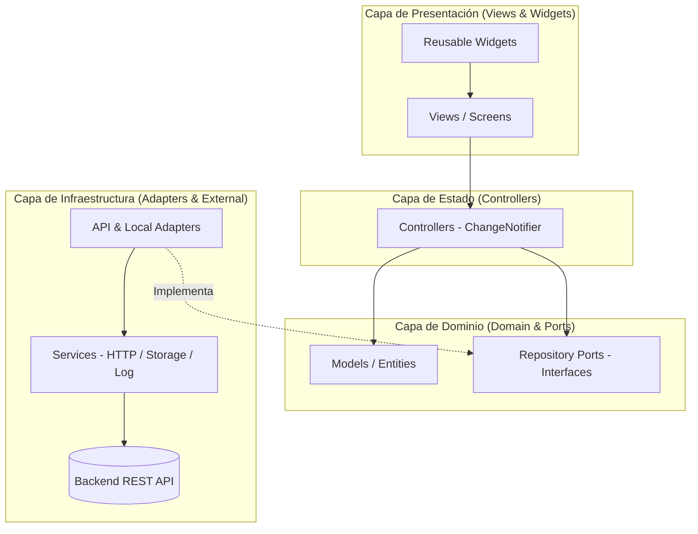

<<<<<<< HEAD
# ☕ Yireh Store — Frontend Móvil

[](https://flutter.dev)
[](https://dart.dev)
[](https://en.wikipedia.org/wiki/Hexagonal_architecture_(software))
[](https://m3.material.io)

Aplicación móvil desarrollada en **Flutter** para **Yireh Store**, una plataforma de cafetería moderna y tienda digital escolar/universitaria. El frontend implementa una **Arquitectura Hexagonal (Puertos y Adaptadores)**, gestión de estado reactiva *local-first*, integración completa con backend REST (Spring Boot), billetera virtual, checkout multi-método, historial de compras y un completo panel de administración con cocina/despacho de pedidos en tiempo real.

---

## 📋 Tabla de Contenidos

- [Características Principales](#-características-principales)
- [Stack Tecnológico](#-stack-tecnológico)
- [Arquitectura de Software](#-arquitectura-de-software)
- [Estructura del Proyecto](#-estructura-del-proyecto)
- [Módulos del Sistema](#-módulos-del-sistema)
  - [1. Autenticación y Sesión](#1-autenticación-y-sesión)
  - [2. Catálogo y Tienda](#2-catálogo-y-tienda)
  - [3. Carrito de Compras y Checkout](#3-carrito-de-compras-y-checkout)
  - [4. Billetera Virtual y Recargas](#4-billetera-virtual-y-recargas)
  - [5. Seguimiento de Pedidos (Cliente)](#5-seguimiento-de-pedidos-cliente)
  - [6. Perfil de Usuario](#6-perfil-de-usuario)
  - [7. Panel de Administración (ADMIN)](#7-panel-de-administración-admin)
- [Sistema de Diseño (Design System)](#-sistema-de-diseño-design-system)
- [Servicios Transversales](#-servicios-transversales)
- [Instalación y Configuración](#-instalación-y-configuración)
- [Pruebas y Análisis](#-pruebas-y-análisis)

---

=======

Aplicación móvil desarrollada en **Flutter** para **Yireh Store**, una plataforma de cafetería moderna y tienda digital escolar/universitaria. El frontend implementa una **Arquitectura Hexagonal (Puertos y Adaptadores)**, gestión de estado reactiva *local-first*, integración completa con backend REST (Spring Boot), billetera virtual, checkout multi-método, historial de compras y un completo panel de administración con cocina/despacho de pedidos en tiempo real.

---

## 📋 Tabla de Contenidos

- [Características Principales](#-características-principales)
- [Stack Tecnológico](#-stack-tecnológico)
- [Arquitectura de Software](#-arquitectura-de-software)
- [Estructura del Proyecto](#-estructura-del-proyecto)
- [Módulos del Sistema](#-módulos-del-sistema)
  - [1. Autenticación y Sesión](#1-autenticación-y-sesión)
  - [2. Catálogo y Tienda](#2-catálogo-y-tienda)
  - [3. Carrito de Compras y Checkout](#3-carrito-de-compras-y-checkout)
  - [4. Billetera Virtual y Recargas](#4-billetera-virtual-y-recargas)
  - [5. Seguimiento de Pedidos (Cliente)](#5-seguimiento-de-pedidos-cliente)
  - [6. Perfil de Usuario](#6-perfil-de-usuario)
  - [7. Panel de Administración (ADMIN)](#7-panel-de-administración-admin)
- [Sistema de Diseño (Design System)](#-sistema-de-diseño-design-system)
- [Servicios Transversales](#-servicios-transversales)
- [Instalación y Configuración](#-instalación-y-configuración)
- [Pruebas y Análisis](#-pruebas-y-análisis)

---

>>>>>>> 56eec6299d6c85f02b4ca28cbb4171a4e20e68ad
## ✨ Características Principales

- 🔐 **Autenticación Segura**: Login, Registro, persistencia de token JWT en almacenamiento local (`SharedPreferences`) y sesión continua al abrir la app.
- 🛍️ **Catálogo Dinámico**: Búsqueda en tiempo real, filtro interactivo por categorías, promociones y visualización detallada de productos.
- 🛒 **Carrito Local-First**: Operaciones instantáneas en memoria con sincronización transparente en segundo plano contra el backend.
- 💳 **Billetera Digital**: Consulta de saldo en tiempo real, múltiples canales de recarga simulados/integrados (PSE, Nequi, Daviplata, Tarjetas) e historial de transacciones.
- 📦 **Checkout Flexible**: Pago con saldo de billetera virtual o efectivo en caja, especificación de punto de entrega y notas de preparación.
- ⏱️ **Monitoreo de Pedidos en Vivo**: Tablero para administradores con actualización de estados en tiempo real (Pendiente ➔ En preparación ➔ Listo para recoger ➔ Entregado).
- 🛠️ **Gestión Administrativa Completa**: CRUD de categorías con personalización de iconos y colores, catálogo de productos con subida de imágenes y administración de usuarios/roles.
- 📱 **Diseño 100% Responsivo**: Adaptabilidad comprobada para smartphones compactos, estándar y tablets.

---

## 🛠️ Stack Tecnológico

| Tecnología / Paquete | Versión | Propósito |
| :--- | :--- | :--- |
| **Flutter SDK** | `>=3.13.1` | Framework multiplataforma de interfaz de usuario |
| **Dart** | `^3.13.1` | Lenguaje de programación con tipado fuerte y null-safety |
| [**http**](https://pub.dev/packages/http) | `^1.6.0` | Cliente HTTP para consumo de API REST |
| [**shared_preferences**](https://pub.dev/packages/shared_preferences) | `^2.5.0` | Persistencia en disco de tokens JWT y datos de sesión |
| [**intl**](https://pub.dev/packages/intl) | `^0.19.0` | Formateo numérico, divisas (COP/USD) y fechas |
| [**image_picker**](https://pub.dev/packages/image_picker) | `^1.1.2` | Selección y captura de fotos para productos desde galería o cámara |
| [**cupertino_icons**](https://pub.dev/packages/cupertino_icons) | `^1.0.8` | Glifos e iconos estilo iOS |
| [**flutter_lints**](https://pub.dev/packages/flutter_lints) | `^6.0.0` | Análisis estático y reglas de buenas prácticas |

---

## 🏛️ Arquitectura de Software

El proyecto sigue una **Arquitectura Hexagonal (Ports and Adapters)** combinada con **Clean Architecture** y principios **SOLID**:



### Principios Clave Implementados:
1. **DIP (Dependency Inversion Principle)**: Los controladores de estado no dependen de implementaciones HTTP directas, sino de abstracciones de puertos (`CartRepositoryPort`, `ProductRepositoryPort`, `OrderRepositoryPort`, `WalletRepositoryPort`).
2. **SRP (Single Responsibility Principle)**: Cada controlador se encarga de un dominio específico (`CartController`, `HomeController`, `CategoryController`, `AdminController`, `AuthController`).
3. **Estrategia Local-First**: En operaciones críticas como el carrito, la UI responde al instante a las acciones del usuario y sincroniza de forma asíncrona en el fondo, evitando bloqueos por latencia de red.

---

## 📁 Estructura del Proyecto

```text
lib/
├── main.dart                      # Punto de entrada de la aplicación y Zone Guarded
├── controllers/                   # Orquestadores de estado (ChangeNotifier)
│   ├── admin_controller.dart      # Gestión de usuarios y roles
│   ├── auth_controller.dart       # Lógica de login, registro y sesión
│   ├── cart_controller.dart       # Gestión de items y totales del carrito (local-first)
│   ├── category_controller.dart   # CRUD de categorías
│   ├── home_controller.dart       # Catálogo, filtros y búsqueda
│   └── profile_controller.dart    # Información de perfil de usuario
├── domain/                        # Núcleo del dominio (Abstracciones)
│   └── port/
│       └── out/                   # Puertos de salida (Interfaces de repositorios)
│           ├── cart_repository_port.dart
│           ├── order_repository_port.dart
│           ├── product_repository_port.dart
│           └── wallet_repository_port.dart
├── infrastructure/                # Implementación de adaptadores externos
│   └── adapter/
│       └── out/
│           ├── api_cart_repository.dart
│           ├── api_order_repository.dart
│           ├── api_product_repository.dart
│           ├── api_wallet_repository.dart
│           └── local_cart_repository.dart
├── models/                        # Modelos de datos y DTOs
│   ├── cart_item_model.dart       # Modelo de producto en carrito
│   ├── category_model.dart       # Categoría con icono y configuración visual
│   ├── order_model.dart          # Modelo de pedido, estados y desglose
│   ├── product_model.dart        # Modelo de producto, precio y stock
│   ├── user_model.dart           # Modelo de usuario, tokens y roles (USER/ADMIN)
│   └── wallet_model.dart         # Saldo y transacciones de recargas
├── repositories/                  # Repositorios directos adicionales
│   └── auth_repository.dart      # Repositorio de autenticación
├── services/                      # Servicios transversales y comunicación HTTP
│   ├── admin_service.dart         # Endpoints administrativos
│   ├── alert_service.dart         # Feedback visual desacoplado (SnackBars, Modals)
│   ├── auth_service.dart          # Endpoints de login y registro
│   ├── category_service.dart      # Consumo de API de categorías
│   ├── http_log_interceptor.dart  # Interceptor para trazabilidad de requests/responses
│   ├── log_service.dart           # Servicio centralizado de logs
│   ├── product_service.dart       # Consumo de API de productos
│   ├── token_storage.dart         # Guardado seguro en SharedPreferences
│   └── user_service.dart          # Actualización y consulta de usuarios
├── theme/                         # Sistema de diseño y estilos visuales
│   ├── app_colors.dart            # Paleta de color cálida (espresso, crema, dorado)
│   ├── app_text_styles.dart       # Jerarquía tipográfica
│   └── app_theme.dart             # ThemeData unificado para Material 3
├── utils/                         # Utilidades y configuración global
│   ├── constants.dart             # IP y Base URL de la API REST
│   ├── responsive.dart            # Breakpoints y helpers para adaptabilidad
│   └── validators.dart            # Validadores de formularios (email, contraseña, etc.)
├── views/                         # Pantallas de la aplicación
│   ├── splash_view.dart           # Splash screen y chequeo de sesión automática
│   ├── auth/                      # Vistas de autenticación
│   │   ├── login_view.dart        # Inicio de sesión
│   │   └── register_view.dart     # Registro de nuevos clientes
│   └── home/                      # Flujo principal y navegación
│       ├── home_view.dart         # Vista contenedora principal (IndexedStack)
│       ├── product_detail_view.dart # Vista detallada y selector de cantidades
│       ├── carrito_view.dart      # Resumen de compra y control de cantidades
│       ├── checkout_dialog.dart   # Diálogo de confirmación de pedido y pago
│       ├── recargas_view.dart     # Billetera digital y recarga de saldo
│       ├── my_orders_view.dart    # Historial de compras del usuario
│       ├── perfil_view.dart       # Perfil del usuario y enlaces rápidos
│       ├── edit_profile_dialog.dart # Modal para edición de datos personales
│       ├── admin_panel_view.dart  # Panel central de control administrativo
│       ├── admin_orders_view.dart # Monitor de pedidos en cocina / despacho
│       ├── categories_view.dart   # Administración de categorías y catálogo
│       ├── create_category_view.dart # Formulario de nueva categoría
│       ├── create_product_view.dart  # Formulario de nuevo producto
│       ├── users_view.dart        # Listado de usuarios del sistema
│       └── create_user_view.dart  # Formulario para registrar usuarios/administradores
└── widgets/                       # Componentes reutilizables de UI
    ├── app_logo.dart              # Logo oficial con fallback vectorizado
    ├── auth_tab_selector.dart     # Selector animado entre Login y Registro
    ├── category_chip.dart         # Chip interactivo para filtrado de catálogo
    ├── custom_bottom_nav_bar.dart # Barra de navegación inferior flotante y estilizada
    ├── custom_divider.dart        # Divisores decorativos con etiqueta
    ├── custom_search_bar.dart     # Barra de búsqueda con limpieza rápida
    ├── custom_text_field.dart     # Campo de texto estandarizado con iconos y validación
    ├── primary_button.dart        # Botón primario con soporte para estado de carga
    └── product_card.dart          # Tarjeta de producto con badge de precio y stock
```

---

## 🧩 Módulos del Sistema

### 1. Autenticación y Sesión
- **Login y Registro:** Formularios con validación en vivo, control de visibilidad de contraseñas y feedback inmediato.
- **Manejo de Sesión (`TokenStorage`):** Guarda el token JWT y los datos del usuario en `SharedPreferences`.
- **Auto-Login (`SplashView`):** Al abrir la app, valida si existe un token vigente y redirige al usuario automáticamente a `HomeView` sin necesidad de volver a autenticarse.

### 2. Catálogo y Tienda
- **Banner Promocional:** Carrusel visual con ofertas y destacados.
- **Filtrado por Categorías:** Chips dinámicos que muestran el conteo de ítems y permiten alternar entre categorías.
- **Buscador en Tiempo Real:** Búsqueda reactiva por nombre o descripción de producto.
- **Detalle de Producto (`ProductDetailView`):** Vista enriquecida con información nutricional/descripción, control de cantidad y botón directo de compra.

### 3. Carrito de Compras y Checkout
- **Estrategia Local-First:** Permite añadir, restar o remover productos instantáneamente sin esperar respuesta del servidor.
- **Cálculo Dinámico:** Subtotal, descuentos e impuestos reflejados en tiempo real.
- **Modal de Checkout (`CheckoutDialog`):**
  - Selección de método de pago: **Billetera Virtual** (con verificación de fondos suficientes) o **Efectivo en Caja**.
  - Especificación de mesa, punto de entrega y notas especiales para la cocina.
  - Vaciado automático del carrito y actualización del saldo tras un pedido exitoso.

### 4. Billetera Virtual y Recargas
- **Saldo Disponible:** Tarjeta destacada con el balance actual del cliente.
- **Canales de Recarga:** Integración de métodos de pago simulados (Nequi, Daviplata, PSE, Tarjeta de Crédito/Débito y Efectivo).
- **Historial de Movimientos:** Listado detallado de transacciones con referencias, fecha y estado de aprobación.

### 5. Seguimiento de Pedidos (Cliente)
- **Mis Pedidos (`MyOrdersView`):** Lista histórica de pedidos realizados.
- **Estados de Pedido:**
  - `PENDING` (Pendiente)
  - `CONFIRMED` (Confirmado)
  - `PREPARING` (En preparación)
  - `READY` (Listo para recoger)
  - `DELIVERED` (Entregado)
  - `CANCELLED` (Cancelado)
- Desglose detallado de productos por pedido y total cancelado.

### 6. Perfil de Usuario
- Visualización de datos de cuenta (Nombre, Teléfono, Correo y Rol).
- Acceso directo al historial de compras y recargas.
- Diálogo para actualización de nombre y teléfono.
- Botón de acceso exclusivo al **Panel de Administración** si el usuario tiene el rol `ADMIN`.
- Cierre de sesión seguro con limpieza de almacenamiento local.

### 7. Panel de Administración (ADMIN)
- **Pedidos en Vivo / Cocina (`AdminOrdersView`):** Monitoreo estilo KDS (Kitchen Display System) para el personal de preparación y entrega, con cambio de estado rápido mediante un toque.
- **Gestor de Categorías (`CategoriesView`):** Creación, edición y activación/desactivación de categorías con asignación de iconos y orden visual.
- **Gestor de Productos (`CreateProductView`):** Formulario para crear o editar productos, asignación de categoría, precio, stock disponible y selección de imagen desde la cámara o galería.
- **Gestor de Usuarios (`UsersView` & `CreateUserView`):** Listado y registro de nuevos usuarios asignándoles rol estándar (`USER`) o privilegios de administrador (`ADMIN`).

---

## 🎨 Sistema de Diseño (Design System)

La aplicación utiliza una paleta de colores cálida inspirada en cafeterías de especialidad:

| Muestra | Nombre | Valor Hex | Uso Principal |
| :---: | :--- | :--- | :--- |
|  | `AppColors.primary` | `#5C3D2E` | Tono café espresso tostado, botones principales, AppBars |
|  | `AppColors.accent` | `#C8956C` | Tono dorado cálido, badges, acentos y selecciones activas |
|  | `AppColors.background` | `#F8F5F1` | Fondo general crema suave para descanso visual |
|  | `AppColors.surface` | `#FFFFFF` | Fondo de tarjetas, modales y formularios |
|  | `AppColors.textPrimary` | `#2C1810` | Tipografía principal y títulos destacados |
|  | `AppColors.success` | `#4CAF50` | Estados exitosos, recargas aprobadas, pedidos entregados |

---

## ⚙️ Servicios Transversales

- **`AlertService`**: Notificaciones desacopladas y enriquecidas mediante `ScaffoldMessenger` flotante (éxito, error, advertencias y modales de confirmación).
- **`LogService` & `HttpLogInterceptor`**: Trazabilidad completa de peticiones HTTP en consola y captura de excepciones no controladas mediante `runZonedGuarded` en `main.dart`.
- **`Responsive`**: Clase de utilidad con cálculos proporcionales de ancho, alto y detección de pantallas (móvil, tablet, orientación horizontal).

---

## 🚀 Instalación y Configuración

### Prerrequisitos
- [Flutter SDK](https://docs.flutter.dev/get-started/install) versión **3.13.0** o superior.
- [Dart SDK](https://dart.dev/get-dart) versión **3.13.1** o superior.
- Dispositivo móvil físico con depuración USB habilitada o un emulador de Android / iOS configurado.

### 1. Clonar el repositorio
```bash
git clone <URL_DEL_REPOSITORIO>
cd frontend_yireh_store
```

### 2. Instalar dependencias
```bash
flutter pub get
```

### 3. Configurar la URL del Backend
Abre el archivo `lib/utils/constants.dart` y ajusta la dirección IP de tu servidor backend:

```dart
class AppConstants {
  AppConstants._();

  static const appName = 'Yireh Store';
  static const logoAsset = 'assets/images/logo.png';

  // Configuración de red:
  // - Emulador Android: usa 'http://10.0.2.2:8080/api'
  // - Dispositivo físico: usa la IP local de tu PC, ej. 'http://192.168.1.X:8080/api'
  // - Pruebas Web / Desktop: usa 'http://localhost:8080/api'
  static const apiBaseUrl = 'http://172.20.1.5:8080/api';
}
```

### 4. Ejecutar la aplicación

- **En Android (dispositivo físico o emulador):**
  ```bash
  flutter run
  ```
- **En navegador Web:**
  ```bash
  flutter run -d chrome
  ```
- **En Windows Desktop:**
  ```bash
  flutter run -d windows
  ```

---

## 🧪 Pruebas y Análisis

El proyecto incluye tests automáticos para asegurar la adaptabilidad de la interfaz en múltiples resoluciones de pantalla y evitar errores de desbordamiento (*overflow*):

```bash
# Ejecutar todas las pruebas unitarias y de widgets
flutter test

# Ejecutar el análisis estático de código
flutter analyze
```

---

## 📄 Licencia

Este proyecto es desarrollado con fines académicos y de producción para la cafetería **Yireh Store**. Todos los derechos reservados.
